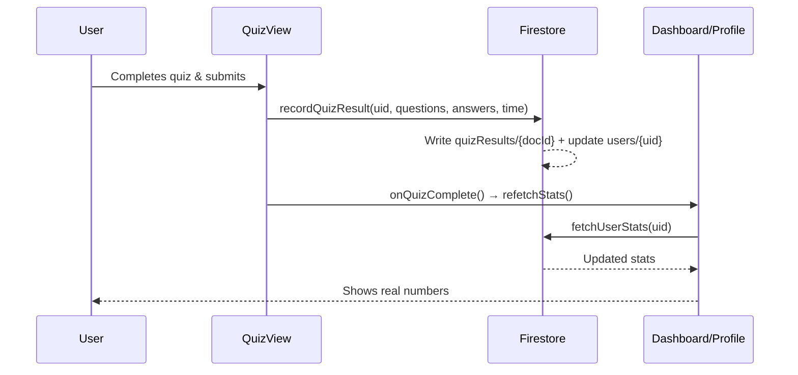

# Firestore Schema — User Stats

## Collection: `users/{uid}`

Stores **aggregated stats** per user. Auto-created on first login or first quiz.

| Field | Type | Description |
|---|---|---|
| `totalQuestions` | `number` | Lifetime questions answered |
| `totalCorrect` | `number` | Lifetime correct answers |
| `accuracy` | `number` | 0–100, auto-calculated |
| `currentStreak` | `number` | Consecutive days with ≥1 quiz |
| `longestStreak` | `number` | All-time best streak |
| `lastQuizDate` | `string \| null` | ISO date (YYYY-MM-DD) of last quiz |
| `topSubject` | `string \| null` | Subject with the most answers |
| `subjectBreakdown` | `map` | `{ [subject]: { answered, correct } }` |
| `quizzesTaken` | `number` | Total quiz completions |
| `createdAt` | `timestamp` | Firestore server timestamp |
| `updatedAt` | `timestamp` | Firestore server timestamp |

## Sub-collection: `users/{uid}/quizResults/{docId}`

Individual quiz result records for history/analytics.

| Field | Type | Description |
|---|---|---|
| `score` | `number` | Correct answers in this quiz |
| `total` | `number` | Total questions in this quiz |
| `accuracy` | `number` | Quiz-level accuracy (0–100) |
| `subjects` | `string[]` | Unique subjects in this quiz |
| `answeredAt` | `timestamp` | When the quiz was submitted |
| `timeTakenSeconds` | `number` | Time spent on the quiz |
| `details` | `array` | Per-question breakdown (see below) |

### `details[]` item shape

| Field | Type | Description |
|---|---|---|
| `questionId` | `number` | Question ID |
| `subject` | `string` | Subject of the question |
| `correct` | `boolean` | Whether the answer was correct |
| `selectedOption` | `number \| null` | Index the user picked |
| `correctOption` | `number` | Index of the correct answer |

## Collection: `schools/{slug}`

Stores collaborated and submitted schools. Managed by admin approval.

| Field | Type | Description |
|---|---|---|
| `name` | `string` | Display name of the school |
| `slug` | `string` | URL-safe unique identifier (document ID) |
| `approved` | `boolean` | `true` = visible to all users, `false` = pending admin review |
| `submittedBy` | `string \| null` | UID of the student who submitted (null for seeded defaults) |
| `createdAt` | `timestamp` | Firestore server timestamp |

---

## Files Changed

| File | What changed |
|---|---|
| [firebase.ts](file:///c:/Users/ADMIN/Downloads/StudyOS/lib/firebase.ts) | Added Firestore import & `db` export |
| [user-stats.ts](file:///c:/Users/ADMIN/Downloads/StudyOS/lib/user-stats.ts) | **New** — Schema types, `ensureUserStats`, `fetchUserStats`, `recordQuizResult`, `fetchRecentQuizResults` |
| [use-user-stats.ts](file:///c:/Users/ADMIN/Downloads/StudyOS/hooks/use-user-stats.ts) | **New** — React hook for fetching stats with loading/error states |
| [page.tsx](file:///c:/Users/ADMIN/Downloads/StudyOS/app/page.tsx) | Wires `useUserStats` hook, passes stats to dashboard/profile, adds `onQuizComplete` callback |
| [dashboard-view.tsx](file:///c:/Users/ADMIN/Downloads/StudyOS/components/dashboard-view.tsx) | Shows real stats (questions, accuracy, top subject, streak) from Firestore |
| [profile-view.tsx](file:///c:/Users/ADMIN/Downloads/StudyOS/components/profile-view.tsx) | Shows real stats + quizzes taken, with loading pulse animation |
| [quiz-view.tsx](file:///c:/Users/ADMIN/Downloads/StudyOS/components/quiz-view.tsx) | Records results to Firestore on submit, refreshes stats on exit |

## Data Flow



> [!IMPORTANT]
> **Firestore Rules**: You need to set up security rules in the Firebase Console to allow authenticated users to read/write only their own document. Example:
> ```
> rules_version = '2';
> service cloud.firestore {
>   match /databases/{database}/documents {
>     match /users/{userId} {
>       allow read, write: if request.auth != null && request.auth.uid == userId;
>       match /quizResults/{resultId} {
>         allow read, write: if request.auth != null && request.auth.uid == userId;
>       }
>     }
>   }
> }
> ```
